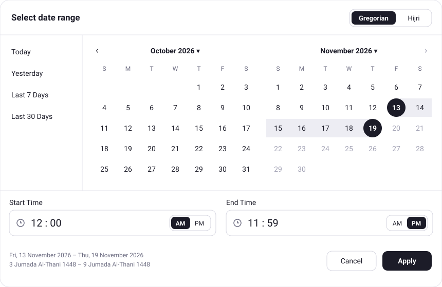

# dual_date_range_picker

[](https://pub.dev/packages/dual_date_range_picker)
[](https://github.com/senkop/dual_date_range_picker/actions/workflows/ci.yml)
[](LICENSE)

A date range picker for Flutter that switches between the **Gregorian** and **Hijri (Umm al-Qura)** calendars with one tap.

- Gregorian / Hijri toggle, with both dates shown in the summary
- Quick presets: Today, Yesterday, Last 7 Days, Last 30 Days, or your own
- Start and end time fields with AM/PM
- Two months side by side on wide screens, one month on phones
- English and Arabic labels, right-to-left ready
- Uses your app's `ColorScheme`



## Install

```bash
flutter pub add dual_date_range_picker
```

## Usage

```dart
import 'package:dual_date_range_picker/dual_date_range_picker.dart';

final DateTimeRange? range = await showDualDateRangePicker(
  context: context,
  lastDate: DateTime.now(),
);

if (range != null) {
  print('${range.start} → ${range.end}');
}
```

### Arabic

```dart
await showDualDateRangePicker(
  context: context,
  labels: DualPickerLabels.arabic,
  initialCalendar: CalendarKind.hijri,
);
```

Wrap your app (or the page) in an RTL `Directionality` or use an Arabic locale to get the right-to-left layout.

### Custom presets

```dart
await showDualDateRangePicker(
  context: context,
  presets: [
    DateRangePreset(
      label: 'This month',
      resolve: (now) => DateTimeRange(
        start: DateTime(now.year, now.month),
        end: DateTime(now.year, now.month, now.day, 23, 59),
      ),
    ),
    DateRangePreset(
      label: 'Last 90 days',
      resolve: (now) => DateRangePreset.days(now, 89, 0),
    ),
  ],
);
```

## Options

| Parameter | Default | Description |
| --- | --- | --- |
| `initialRange` | `null` | Range selected when the dialog opens |
| `firstDate` | 1 Jan 2000 | Earliest selectable day |
| `lastDate` | 31 Dec 2075 | Latest selectable day |
| `currentDate` | now | "Today" for highlighting and presets |
| `initialCalendar` | `gregorian` | Calendar shown first |
| `presets` | Today, Yesterday, Last 7/30 Days | Quick picks. Pass `[]` to hide them |
| `showTime` | `true` | Show the start and end time fields |
| `showCalendarToggle` | `true` | Show the Gregorian/Hijri toggle |
| `firstDayOfWeek` | `DateTime.sunday` | First column of the calendar |
| `labels` | `DualPickerLabels.english` | All text, or `DualPickerLabels.arabic` |

Without a time selection, ranges run from 00:00 on the first day to 23:59 on the last day.

Hijri dates use the Umm al-Qura tables from the [`hijri`](https://pub.dev/packages/hijri) package, which cover roughly 1937–2077.

## Example

```bash
cd example
flutter create .
flutter run -d chrome
```

## License

MIT
